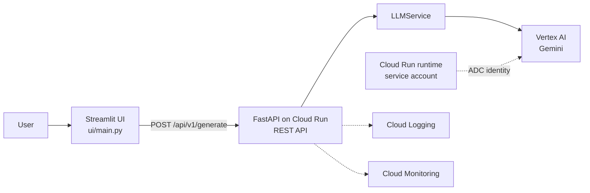
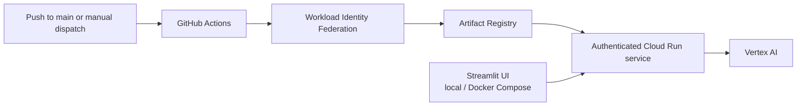

# Production AI Architecture

## Overview

The retained application consists of two code directories:

- `app/`: FastAPI REST API and Vertex AI service.
- `ui/`: Streamlit client that calls the REST API.

The backend can run locally or on Cloud Run. The backend API is currently public and has no application-level user authentication. Google Cloud access to Vertex AI is provided by Application Default Credentials locally and the Cloud Run runtime service account in production.

## Runtime Schema

## Request Flow

1. A user submits a prompt in Streamlit.
2. The Streamlit server sends the prompt to `POST /api/v1/generate`.
3. FastAPI calls `LLMService`, which lazily initializes the configured Vertex AI Gemini model.
4. The service returns the generated answer to the API, which returns it to Streamlit.

The generation API accepts `{ "query": "..." }` and returns `{ "answer": "..." }`. It does not authenticate callers or persist conversation sessions.

## Deployment Schema

`.github/workflows/deploy-backend-public.yml` builds and deploys only the backend. GitHub uses WIF to obtain short-lived deployment credentials. Cloud Run requires IAM authentication; grant `roles/run.invoker` only to intended callers. The runtime service account needs `roles/aiplatform.user` for Vertex AI. The workflow does not deploy the Streamlit UI.

## Configuration and Operations

- `GCP_PROJECT_ID`, `VERTEX_AI_LOCATION`, and `VERTEX_AI_MODEL` select the Vertex AI project, region, and model.
- Local Vertex AI access uses `gcloud auth application-default login`.
- In Cloud Run, Vertex AI access uses the attached runtime service account. No Vertex API key is stored in the repository.
- Optional MLflow tracing is configured with `ENABLE_MLFLOW`, `MLFLOW_TRACKING_URI`, and `MLFLOW_EXPERIMENT_NAME`.
- Cloud Run provides request logs and basic service metrics; production use should add explicit alerts and quotas. Only principals granted Cloud Run Invoker can call the deployed API.
- Docker Compose runs FastAPI on port `8000` and Streamlit on port `8501`.
